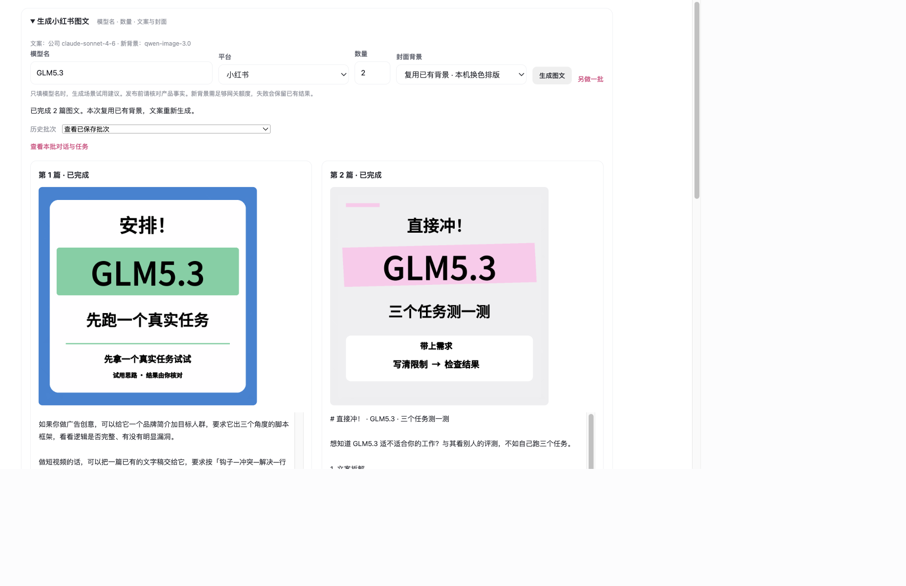

# Hanabi 小红书图文使用说明

2026-11-01 已在当前 Hanabi 实测：输入 **GLM5.3**、数量 **2**，页面显示两篇文案与两张封面，刷新及后台服务重启后结果仍在。

## lilith 和思敏怎么用

1. 打开 Hanabi，点左上角「Hanabi／内容工作台」。
2. 展开顶部「生成小红书图文」。
3. 模型名填 `GLM5.3`（或其他产品名），平台选「小红书」，数量填 `2`。
4. 当前选「复用已有背景 · 本机换色排版」。文案仍由公司 Claude 新生成，每篇封面换色并采用不同结构。公司网关余额不足，选择「生成新背景」会失败，补充额度后再用。
5. 点「生成图文」。已实测这一批约一分钟；实际时间取决于网关，页面会显示真实进度，不保证固定秒数。
6. 完成后，每篇可「复制文案」「保存图片」「燃放预览」。新建了本批对话，可从「查看本批对话与任务」或左侧历史找到。
7. 想重新生成，点「另做一批」。普通重复点击或刷新会复用本次请求，不会自动重复收费。失败会保留已完成部分；停止后不自动重试。

「历史批次」可找回已保存结果。左侧「制花／燃放预览」也能看到这两篇；批量预览中可选择作品，仅看本批。新窗口默认进入内容工作台，刷新恢复原页面。没有自动发布或给同事发消息。

只有模型名时，文案是任务试用建议。正式推广的能力、价格和活动需有产品资料，发布前请核对；当前界面不提供事实资料输入，CLI 支持 `--facts`。生成器执行三轮 Claude：初稿、风格/去 AI 味终审、事实终审；本机再做禁词和格式检查。

## 现在打开的位置

本机服务地址：`http://127.0.0.1:6187`。后台 LaunchAgent 已安装并处于 running，关闭执行终端不会依赖本轮终端存活。

如需手动确认启动：

```bash
cd '/Users/lilith/Documents/ChatGPT/【探索】/content-alchemy'
node scripts/ensure-server.mjs
```

启动备忘中的 Nuxt 路径和 localhost:3000 是猜测。实际当前 Hanabi 是 Electron + Node，端口 6187。10月27日备份比当前开发版和运行版旧，因此本轮只小范围接入最新源码，未用旧备份覆盖当前应用。

## 文件位置与换电脑

| 项目 | 本机路径 |
|---|---|
| content-ops 源码、规则与卡片 | `~/Desktop/content-ops`，已按卡推送 Git |
| Hanabi 最新开发源码 | `~/Documents/ChatGPT/【探索】/content-alchemy` |
| Hanabi 实际运行代码 | `~/Library/Application Support/Content Alchemy/runtime` |
| 小红书独立脚本运行副本 | `~/Library/Application Support/Content Alchemy/content-ops` |
| 界面生成成品 | `~/Library/Application Support/Content Alchemy/content-ops/outputs/<日期>/hanabi/<批次ID>/` |
| 统一数据库与图片附件 | `~/Library/Application Support/Content Alchemy/library.sqlite` 与 `uploads/` |
| 本轮界面验收批次 | `bc45c766-917e-4241-a275-7bd0c6b0190f` |

运行副本避开 macOS 后台服务对桌面目录的权限限制。修改 content-ops 后，在仓库根目录运行 `python3 scripts/install-hanabi-runtime.py` 更新运行所需的脚本、规则、背景和本机配置；不复制企微原文、不覆盖 Hanabi 数据库。令牌仍只在忽略目录和本机应用数据目录，权限 600，不进 Git。

**换电脑时，git pull 只同步 content-ops 代码、规则、文案与说明。** 按 T11 约定，Hanabi 改动仅本机，没有推入 content-ops；生成图片、背景与应用数据也不会靠 Git 自动同步。需要迁移当前 Hanabi 源码/应用数据、背景文件，或在新电脑重新部署并配置公司令牌。不能把当前电脑上的可用界面宣称为另一台电脑已部署。

## 技术维护

- API：`GET /api/content-ops/config`、`POST /api/content-ops/generate`、`GET /api/content-ops/batches`、`GET /api/content-ops/batches/:id`、`POST /api/content-ops/batches/:id/stop`。
- 生成请求：`{model:"GLM5.3",platform:"xhs",count:2,backgroundMode:"cached",requestId:"客户端UUID"}`。写请求复用本机及同源检查。
- Python 使用 argv 调用，`shell:false`，模型名不拼 shell。每批独立目录，数据库保存状态、同一请求标识防重；启动恢复只导入已有文件，不自动重复模型请求。
- 每篇沿原有 analysis_jobs / items(conversation) / uploads 保存，内部上下文不计入资料库；燃放预览、统计与导出复用现有链。25 份资料保持，已完成任务由 8 变 10，预览资源由 27 变 29。
- 修改文件：server.mjs、app.js、index.html、styles.css；新增 lib/content-ops-production.mjs、lib/content-ops-ui.mjs、tests/content-ops-production.test.mjs。原文件备份在 content-ops/work/t11-backup，安装脚本也保留 runtime-previous-*。
- 相关 AI 行为以局部追加同步到开发版、应用知识档案、Codex 三份 ai-content-alchemy/SKILL.md，保留其他用户内容。


