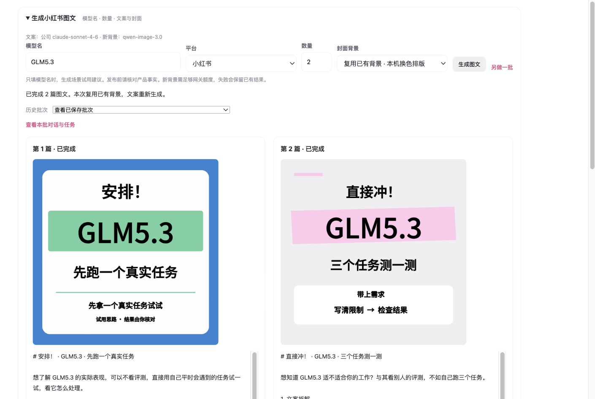
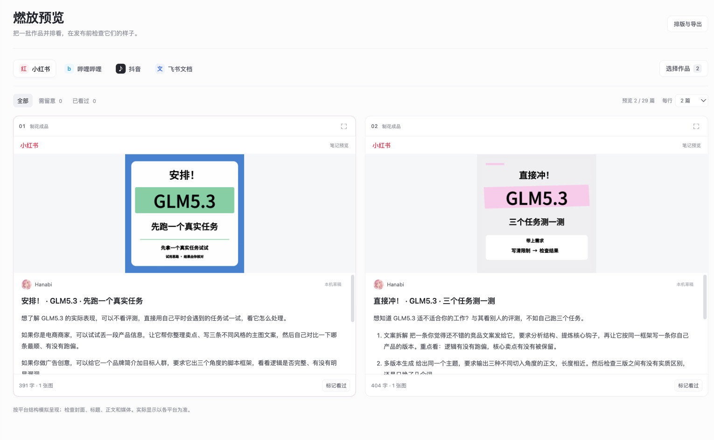

# 2026-11-01 完成报告

给 lilith 和思敏。

**本机 Hanabi 已能输入 `GLM5.3`、数量 `2`，生成并保存两篇小红书文案和两张封面。** 已从真实界面点击生成，刷新和后台服务重新部署后仍能找回同一批结果。当前可用模式是「复用已有背景 · 本机换色排版」；公司网关新背景额度不足，尚不能保证每次全新生图。

## 醒来直接这样用

1. 打开 Hanabi，点「Hanabi／内容工作台」，展开「生成小红书图文」。
2. 模型名填 `GLM5.3`，平台选「小红书」，数量填 `2`。
3. 封面背景选「复用已有背景 · 本机换色排版」，点「生成图文」。文案由公司 Claude 新生成，每篇采用不同配色和结构。
4. 完成后可复制文案、保存图片、进入「燃放预览」。本次验收约一分钟，实际时间取决于网关。
5. 用「历史批次」找回已有结果；需要新作品时点「另做一批」。刷新不会自动重新收费生成。

本机服务为 `http://127.0.0.1:6187`，后台服务已处于 running。详细操作、手动启动及维护方法见[使用说明](../../docs/hanabi-usage.md)。

目前只输入产品名时，产出是场景试用建议。没有产品资料便不编价格、活动、性能和亲测经历；正式推广前仍需核对产品事实。表单暂不提供资料输入，命令行支持 `--facts`。

## 六张任务卡结果

按批次 1 并行、批次 2 串行实施；T04 记录阻塞后，使用已核实的可用产出继续后续任务。

| 卡 | 结果 | 已推送提交 |
|---|---|---|
| T04 企微偏好 | 可用产出已交付，历史补采阻塞。15 条标准、8 个反例、24 行去敏引文、16 条好帖标签；公司 Claude 审核通过 | `ef1d898` |
| T06 图像通路 | 公司 `qwen-image-3.0` 真实出图；模型列表、截图与调用脚本已交付，Q3 已关闭。图反推未验证 | `e0515e5` |
| T03 简化版 | 置顶两篇加随机十条；5 组开场动词、卖点、句式与真实封面配色规则，Claude 已校核 | `6561469` |
| T05 简化版 | quick 风险规则和检查脚本可用；接入企微约束后共 20 条，支持平台、模型范围 | `5f98f26` |
| T08 简化版 | GLM5.3 两篇、Kimi 2.6 一篇已产出；新背景失败后显式缓存续跑，保留已完成结果 | `a4e78be` |
| T11 Hanabi | 真实表单生成 GLM5.3 ×2，文案、图片、历史、预览及恢复验收通过；当前使用缓存背景 | `152fbc2` |

每卡均更新了任务卡「完成记录」、进度总表和 README，并分别提交、推送。T04 保留阻塞状态，没有把历史采集缺口记为全部完成。

## 本次界面生成的两篇

这是从 Hanabi 表单真实生成并保存的同一批作品，封面均为 1080×1080，使用已有 Qwen 背景重新换色排版。两篇文案与海报结构不同。

| 成品 | 文案 | 封面 |
|---|---|---|
| 安排！· GLM5.3 · 先跑一个真实任务 | [第 1 篇](hanabi-验收/post-1.md) | [PNG](hanabi-验收/post-1.png) |
| 直接冲！· GLM5.3 · 三个任务测一测 | [第 2 篇](hanabi-验收/post-2.md) | [PNG](hanabi-验收/post-2.png) |

## 已做的验收

- 真实界面填写 GLM5.3／小红书／2／复用背景，点击生成，两篇均完成。批次 ID：`bc45c766-917e-4241-a275-7bd0c6b0190f`。
- 最终两篇全字段风险检查通过；独立事实终审发现并删除了一处虚构体验开头，最终副本与 Hanabi 中的同一作品已同步修正。
- Python 4 项测试通过：解析、全字段与模型范围检查、失败保留与显式续跑、拒绝覆盖已有结果。生成器现执行三轮 Claude：初稿、风格修订、事实终审。
- Node 18 项测试通过；现有 `test:application-ui` 通过，覆盖 1400／900 宽度、资料与成品联动、刷新恢复和新启动。
- 刷新和后台服务重新部署后仍是同一 completed 批次，未重新调用收费模型。资料库保持 25，完成任务 8→10，预览作品 27→29。
- 图片下载 HTTP 200；原有 Word 导出 HTTP 200。无 Origin 的生成请求返回 403，数量 20 返回 400。停止、部分失败保留、重复请求去重均有实现与测试。
- 收尾再次确认服务健康、配置可用、批次完整；16 条 good 标签存在，两篇终稿均「未命中风险词」。企微原文、截图和本机凭证未被 Git 跟踪。

## 仍然缺什么

**T04 更早企微历史待补。** 最早读到 2026-10-15，未达到 ≥500 条消息或回溯到 2024 年的要求。客户端未继续加载更早历史，随后电脑锁屏，工具无法自动解锁。另有 4 条 Seedance 候选勾选图和 2 条外部参考待核实；全部选帖线索覆盖 16/22，已可靠识别集合匹配 16/16。已记任务卡和 Q8，未编造标签或原话。

**新背景额度不足。** 公司网关返回 403 `insufficient_user_quota`，当时余额约 0.05，Qwen 单次需预扣 0.25。已保留成功背景并提供明确缓存模式；补充公司额度后才可使用「生成新背景」。没有自动换模型或反复计费重试。见 Q9。

**口径冲突待 lilith 定。** D10 与较晚企微反馈对部分「管饱」表达存在范围差异，Q7 保持开放；本轮采用已核实的严格范围，没有擅自改历史决策。

## 换电脑须知

Git 已同步 content-ops 的脚本、规则、任务记录、文案与说明。到另一台电脑先 `git pull`。

按 T11 任务卡约定，**Hanabi 的改动仅部署在本机，未推入 content-ops**；生成 PNG、背景、公司凭证及应用数据库也不靠 Git 同步。另一台电脑需要迁移当前 Hanabi 源码和应用数据、背景，并配置本机公司令牌，不能只拉仓库就直接拥有同样的 Hanabi 界面。

当前开发源码：`~/Documents/ChatGPT/【探索】/content-alchemy`；运行版与独立脚本副本位于 `~/Library/Application Support/Content Alchemy/`。旧的 10 月 27 日备份仅作参考，没有覆盖更新的应用。

随本轮聊天交付的文件包包含两篇最终 MD／PNG、截图和使用说明；不包含企微原文、公司令牌或 Hanabi 数据库。仓库中的 PNG 按既有规则忽略，若只通过 Git 查看本报告，需使用本机交付包或从 Hanabi 保存图片。

本轮没有自动发布帖子，也没有给任何人发送企微消息。
